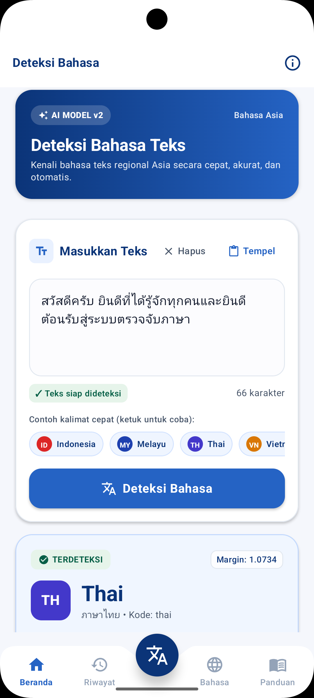
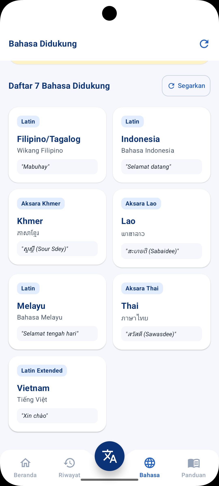
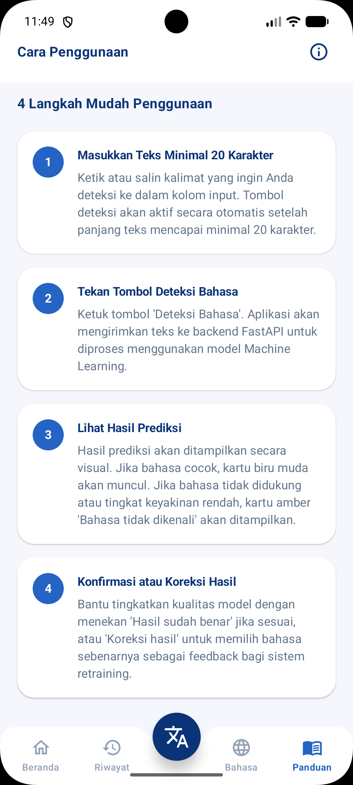

# Deteksi Bahasa Asia

Aplikasi Android untuk pengguna yang ingin mengenali bahasa dari teks beraksara Asia. Aplikasi mengirim teks ke API FastAPI; model *Character TF-IDF* dan *LinearSVC* mengembalikan prediksi bahasa serta **margin score**. Repository ini memuat aplikasi Android, API, model, dan kode pelatihan.

## Fitur

- Mendeteksi bahasa dari teks sepanjang **minimal 20 karakter** melalui `POST /predict`.
- Mendukung **16 bahasa**: Arab, Mandarin, Farsi, Filipino/Tagalog, Ibrani, Hindi, Indonesia, Jepang, Khmer, Korea, Lao, Melayu, Thai, Turki, Urdu, dan Vietnam (sesuai `artifacts/labels.json`).
- Menampilkan margin score sebagai ukuran relatif keyakinan model, **bukan probabilitas terkalibrasi**. Teks yang tidak dikenali dapat menghasilkan status `unknown`.
- Menampilkan daftar bahasa dari `GET /languages`, riwayat deteksi lokal, serta panduan penggunaan di aplikasi Android.
- Mengirim koreksi hasil ke `POST /feedback`; API menyimpannya di SQLite dengan status `PENDING`. Statistik feedback tersedia untuk admin melalui `GET /feedback/stats` dengan token.
- Menyediakan dokumentasi API interaktif di `/docs` serta endpoint pemeriksaan layanan di `/health`.

## Spesifikasi dan kebutuhan minimum

| Komponen | Teknologi / versi |
| --- | --- |
| Backend dan model | Python 3.12+, FastAPI 0.141.1, Uvicorn 0.52.4, scikit-learn 1.9.0, pandas 3.0.5, NumPy 2.5.2 |
| Aplikasi | Kotlin 2.2.10, Jetpack Compose, Android Gradle Plugin 9.3.2, Gradle 9.5.0 |
| Database | SQLite untuk feedback; default `data/feedback.db` |
| Android | Minimum Android 7.0 / API 24; Android SDK dan Android Studio untuk build |
| Lingkungan | Git, Python dan `pip`, serta koneksi dari emulator/perangkat ke API |

Versi paket Python lengkap tercantum di `requirements.txt`. Artifact model (`model.pkl`, `preprocessor.pkl`, dan `labels.json`) tersedia di `artifacts/`. Aplikasi Android memerlukan API aktif untuk melakukan prediksi dan mengirim koreksi.

Hanya model aktif di `artifacts/` yang disertakan dalam repository. Hasil retraining disimpan sementara di `artifacts_candidate/` (diabaikan Git); promosi hanya menerima kandidat dengan daftar bahasa yang sama dan metrik yang lolos pemeriksaan terhadap model aktif.

Inferensi berjalan di backend: Android mengirim teks ke `/predict`, lalu menampilkan hasil model aktif. Tampilan aplikasi menandai model sebagai **AI MODEL V3**. `artifacts/model.pkl` berukuran 5.121.139 byte dan `preprocessor.pkl` 1.433.032 byte. `artifacts/config.json` mencatat pelatihan 8 Oktober 2026, akurasi **98,16%** dan macro F1 **0,9820** pada data uji; angka ini adalah catatan artefak, sedangkan reproduksi dataset dibahas di issue #12.

## Cara menjalankan

Perintah berikut menggunakan PowerShell di Windows. Jalankan dari folder utama repository, kecuali jika disebut lain.

1. **Clone repository dan masuk ke folder project.**

   ```powershell
   git clone https://github.com/Central-Saga/Alexandro-Project2-ML-AsianLanguage.git
   cd Alexandro-Project2-ML-AsianLanguage
   ```

2. **Siapkan Python dan instal dependensi.**

   ```powershell
   py -3.12 -m venv .venv
   .\.venv\Scripts\Activate.ps1
   python -m pip install -r requirements.txt
   ```

3. **Atur konfigurasi.** Salin `.env.example` menjadi `.env` sebagai referensi nilai konfigurasi. Aplikasi **tidak membaca `.env` secara otomatis**, jadi setel variabel lingkungan di terminal sebelum memulai API. `ADMIN_API_TOKEN` diperlukan hanya untuk `/feedback/stats`; `FEEDBACK_API_TOKEN` diperlukan untuk mengirim koreksi; `FEEDBACK_DB_PATH` opsional untuk mengganti lokasi SQLite.

   ```powershell
   Copy-Item .env.example .env
   $env:ADMIN_API_TOKEN = "ganti-dengan-token-acak-yang-panjang"
   $env:FEEDBACK_API_TOKEN = "token-feedback-acak-yang-berbeda"
   # Opsional: $env:FEEDBACK_DB_PATH = "D:\path\ke\feedback.db"
   ```

4. **Jalankan API.**

   ```powershell
   python -m uvicorn api.main:app --host 0.0.0.0 --port 8000
   ```

   Buka `http://127.0.0.1:8000/docs` untuk mencoba endpoint atau `http://127.0.0.1:8000/health` untuk memeriksa kesiapan model. Skema SQLite dibuat otomatis saat API memuat modul database; **tidak ada langkah migrate atau seed** untuk menjalankan aplikasi. Dataset pelatihan tidak perlu diimpor untuk inferensi karena artifact model sudah disertakan.

5. **Jalankan aplikasi Android.** Buka folder `android-app/` di Android Studio, tunggu sinkronisasi Gradle, jalankan emulator Android API 24 atau lebih baru, lalu pilih **Run** untuk modul `app`. Build debug memakai `http://10.0.2.2:8000/` secara default agar emulator dapat mengakses API di komputer. Atur `FEEDBACK_API_TOKEN` dengan nilai yang sama di Gradle properties pengguna (`~/.gradle/gradle.properties`), agar fitur koreksi dapat dipakai. Jangan simpan token di file Gradle yang terlacak Git:

   ```properties
   FEEDBACK_API_TOKEN=token-feedback-acak-yang-berbeda
   ```

   Untuk perangkat fisik, atur `DEBUG_API_BASE_URL` ke alamat IP komputer yang dapat dijangkau perangkat, misalnya di `android-app/gradle.properties` lokal:

   ```properties
   DEBUG_API_BASE_URL=http://192.168.1.10:8000/
   ```

   Untuk build release, setel `RELEASE_API_BASE_URL` ke URL API HTTPS yang aktif. Alamat bawaan release adalah placeholder dan tidak dapat digunakan untuk prediksi.

API membatasi feedback per sumber hingga 10 percobaan/jam dan 50/hari, serta membatasi antrean `PENDING` ke 1.000 baris dan total database ke 10.000 baris. Teks feedback yang sama tidak disimpan berulang. Token aplikasi adalah penghalang ringan dan dapat diekstrak dari APK; untuk distribusi publik, gunakan verifikasi aplikasi seperti Play Integrity atau gateway tepercaya selain batas server ini.

Database `data/feedback.db` berisi teks kiriman pengguna dan tidak disertakan dalam repository. API membuat skemanya saat pertama kali dijalankan; simpan backup atau ekspor data operasional di luar repository.

## Foto dokumentasi

Tiga screenshot aplikasi berikut disimpan di `screenshots/`.

### Deteksi dan hasil prediksi



### Daftar bahasa yang didukung



Screenshot ini diambil pada **7 Oktober 2026** dan masih menampilkan 7 bahasa. Artifact model saat ini memuat **16 bahasa**, sehingga jumlah pada gambar berbeda dari versi sekarang.

### Panduan penggunaan



## Struktur folder

```text
android-app/       Aplikasi Android (Kotlin dan Jetpack Compose)
api/               Endpoint FastAPI
artifacts/         Model, vectorizer, label, dan konfigurasi model
data/              Data contoh dan database feedback SQLite
notebooks/         Eksperimen dan analisis
scripts/           Skrip pendukung
screenshots/       Tiga tangkapan layar dokumentasi aplikasi
src/               Prediksi, preprocessing, pelatihan, dan retraining
tests/             Pengujian Python
README.md          Dokumentasi project
```

## Kredit

**Alexandro** — pengembangan project. Teknologi utama: scikit-learn, FastAPI, Kotlin, dan Jetpack Compose.
